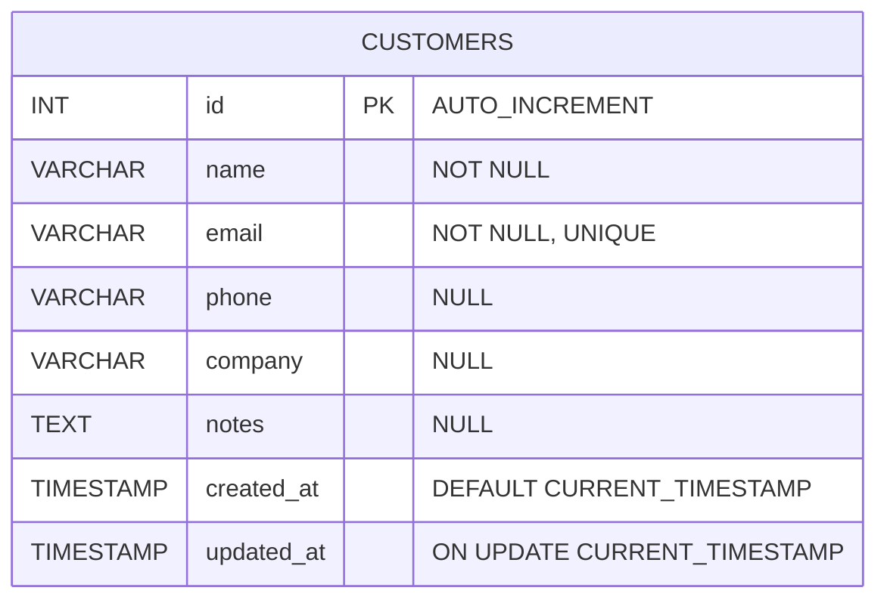

# Customer Contact Manager

A small PHP and MySQL app for managing a customer directory. Built for Week 4 (MySQL, SQL, relational modelling, PDO, CRUD).

## Problem it solves

Customer details usually end up scattered across notes and chats. This app keeps them in one searchable directory backed by a real relational database, so records survive restarts and can be listed, searched, created, edited and deleted safely.

## Features

- List customers, sorted by name
- Search by name, email or company
- Create, view, edit and delete customers
- Server-side validation with friendly error messages
- Duplicate email detection (UNIQUE constraint with a readable message)
- Prepared statements for every query (protects against SQL injection)
- Output escaping (protects against XSS) and a CSRF token on every POST form
- Delete only works via POST, with a confirmation prompt

## Setup

Requirements: XAMPP (PHP 8.1+ and MySQL).

1. Copy this folder to `C:\xampp\htdocs\contact-manager`.
2. Start **Apache** and **MySQL** in the XAMPP Control Panel.
3. Open http://localhost/phpmyadmin, go to the **SQL** tab, paste the contents of `schema.sql` and click **Go**.
4. Edit `config.php` if your MySQL username or password differ from `root` and empty.
5. Open http://localhost/contact-manager

## ERD



## Why this data model

- **`id` as primary key**: a stable identifier that never changes, even if a name or email does. Pages like `view.php?id=3` rely on it.
- **`email` is UNIQUE**: stops the same customer being added twice. The database enforces it even if the PHP validation is bypassed.
- **`name` is indexed**: search and sorting by name stay fast as the table grows.
- **Optional fields are NULL**: phone, company and notes are not always known, so empty means NULL rather than an empty string.
- **Single table**: customers have no related entities yet. A natural next step is an `interactions` table (many interactions per customer, linked by a `customer_id` foreign key).

## Request and data flow (creating a customer)

1. The user opens `create.php` and submits the form (POST).
2. `verify_csrf()` checks the hidden token.
3. `clean_input()` trims the values and `validate_customer()` checks them.
4. If valid, a prepared `INSERT` runs through PDO.
5. MySQL either saves the row or rejects a duplicate email (SQLSTATE `23000`), which is shown as a field error.
6. On success the user is redirected to `view.php?id=...` with a success message.

## Project structure

```
index.php      list and search
create.php     add a customer
view.php       one customer's details
edit.php       update a customer
delete.php     delete (POST only)
config.php     database settings
db.php         PDO connection
helpers.php    escaping, flash messages, CSRF, validation
partials/      header, footer, shared form
assets/        style.css
schema.sql     database and table
```

## Definition of done

- [x] Customer table with appropriate schema
- [x] List and search customers
- [x] Create, view, edit and delete records
- [x] Prepared statements used for database writes and queries
- [x] Validation and friendly error handling
- [x] ERD included in repository documentation

## Retrospective

- **Bug I hit and how I diagnosed it:** (fill this in)
- **What I would improve with another day:** pagination, an `interactions` table, automated tests.
